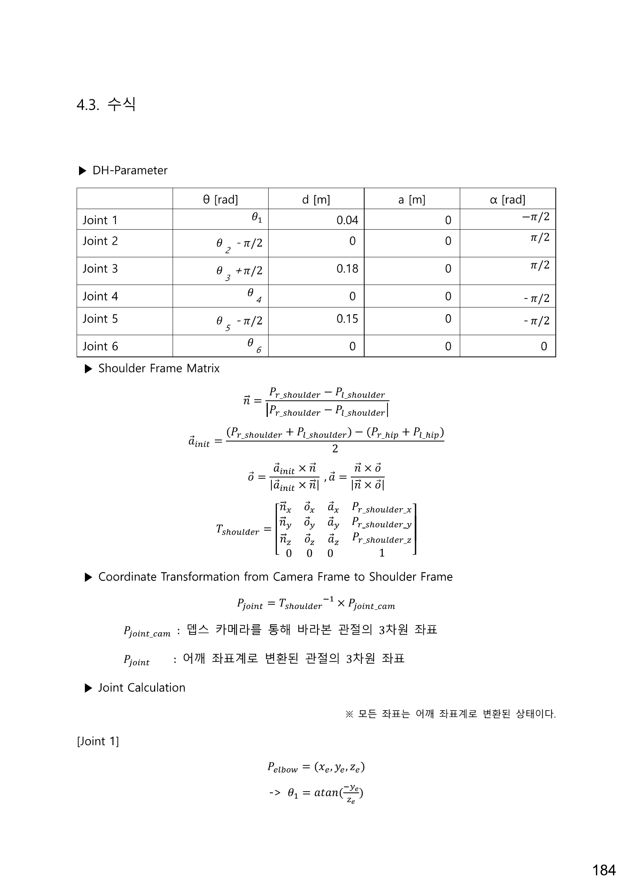
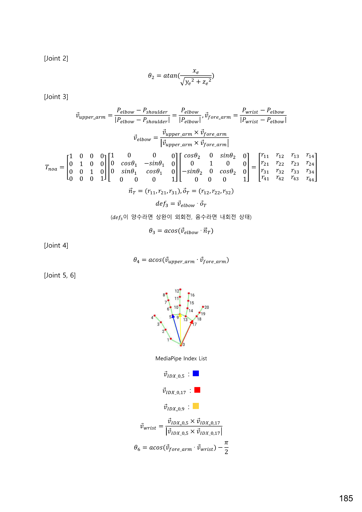
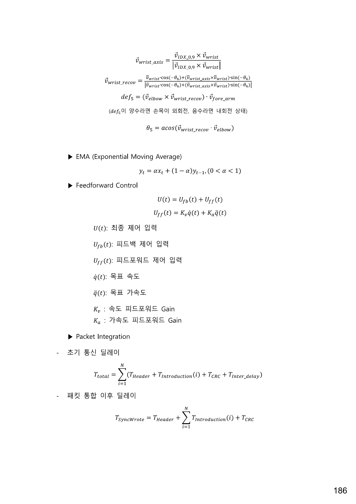

# Geometric IK: Shoulder frame과 관절각 계산

[README로 돌아가기](README.md)

이 문서는 제공된 **「관절 수식.pdf」의 인쇄 페이지 184–186**을 바탕으로, 카메라에서 얻은 인체 관절의 3차원 좌표를 Shoulder frame으로 변환하고 기하학적으로 6개 관절각을 구하는 방법을 정리한다. 수식은 PDF 기준이며, 현재 코드와의 차이는 [구현 시 주의사항](#구현-시-주의사항)에 따로 적었다. 각도 단위는 rad, DH 길이 단위는 m이다.

## 1. 입력 좌표와 표기

모든 입력 점은 같은 카메라 좌표계와 길이 단위를 사용한다.

| 기호 | 의미 |
| --- | --- |
| $P_{r,s}, P_{l,s}$ | 오른쪽·왼쪽 어깨의 3차원 좌표 |
| $P_{r,h}, P_{l,h}$ | 오른쪽·왼쪽 골반의 3차원 좌표 |
| $P_e, P_w$ | Shoulder frame으로 변환한 오른쪽 팔꿈치·손목 좌표 |
| $H_i$ | Shoulder frame으로 변환한 MediaPipe 손 랜드마크 $i$의 좌표 |
| $\|v\|$ | 벡터의 크기 |
| $u\cdot v,\ u\times v$ | 내적·외적 |

어깨 좌표계의 원점은 **오른쪽 어깨**다. 아래 관절각 수식의 점과 벡터는 모두 이 좌표계에서 계산한다.

## 2. Shoulder frame 정의

먼저 왼쪽 어깨에서 오른쪽 어깨로 향하는 단위벡터 $\mathbf n$과, 골반 중심에서 어깨 중심으로 향하는 벡터 $\mathbf a_{init}$을 구한다.

$$
\mathbf n=\frac{P_{r,s}-P_{l,s}}{\|P_{r,s}-P_{l,s}\|}
$$

$$
\mathbf a_{init}=\frac{(P_{r,s}+P_{l,s})-(P_{r,h}+P_{l,h})}{2}
$$

외적으로 나머지 축을 구성한다. $\mathbf a_{init}$을 그대로 쓰지 않고 직교화한 $\mathbf a$를 사용한다.

$$
\mathbf o=\frac{\mathbf a_{init}\times\mathbf n}{\|\mathbf a_{init}\times\mathbf n\|},\qquad
\mathbf a=\frac{\mathbf n\times\mathbf o}{\|\mathbf n\times\mathbf o\|}
$$

| Shoulder 축 | 정의와 방향 |
| --- | --- |
| $x_s=\mathbf n$ | 왼쪽 어깨 → 오른쪽 어깨 |
| $y_s=\mathbf o$ | $\mathbf a_{init}\times\mathbf n$ 방향 |
| $z_s=\mathbf a$ | 어깨선에 직교하도록 보정한 몸통 위쪽 방향 |

회전행렬의 **열**에 세 축을 배치하고, 오른쪽 어깨 좌표를 평행이동 항으로 둔다.

$$
R_s=[\mathbf n\ \mathbf o\ \mathbf a],\qquad
T_s=\begin{bmatrix}
n_x&o_x&a_x&P_{r,s,x}\\
n_y&o_y&a_y&P_{r,s,y}\\
n_z&o_z&a_z&P_{r,s,z}\\
0&0&0&1
\end{bmatrix}
$$

$T_s$는 Shoulder frame의 좌표를 카메라 좌표로 보내는 변환이다. 따라서 카메라에서 관측한 점은 역행렬로 변환한다.

$$
\begin{bmatrix}P_{joint}\\1\end{bmatrix}
=T_s^{-1}\begin{bmatrix}P_{joint,cam}\\1\end{bmatrix}
$$

직교 회전행렬의 성질을 쓰면 같은 계산을 다음과 같이 표현할 수 있다.

$$
P_{joint}=R_s^T(P_{joint,cam}-P_{r,s})
$$

이때 오른쪽 어깨는 $(0,0,0)$이 된다.

## 3. 로봇의 DH parameter

PDF의 DH parameter는 다음과 같다. 두 번째 열은 DH 변환에 넣는 각도로, 계산된 관절각에 고정 오프셋이 더해진다.

| Joint | DH 각도 | $d$ [m] | $a$ [m] | $\alpha$ [rad] |
| --- | --- | --- | --- | --- |
| 1 | $\theta_1$ | 0.04 | 0 | $-\pi/2$ |
| 2 | $\theta_2-\pi/2$ | 0 | 0 | $\pi/2$ |
| 3 | $\theta_3+\pi/2$ | 0.18 | 0 | $\pi/2$ |
| 4 | $\theta_4$ | 0 | 0 | $-\pi/2$ |
| 5 | $\theta_5-\pi/2$ | 0.15 | 0 | $-\pi/2$ |
| 6 | $\theta_6$ | 0 | 0 | 0 |

## 4. 어깨와 팔꿈치: Joint 1–4

### Joint 1

팔꿈치 좌표를 $P_e=(x_e,y_e,z_e)$라 하면, PDF의 식은 다음과 같다.

$$
\theta_1=\arctan\left(\frac{-y_e}{z_e}\right)
$$

### Joint 2

$$
\theta_2=\arctan\left(\frac{x_e}{\sqrt{y_e^2+z_e^2}}\right)
$$

### Joint 3: 상완 회전

상완과 전완의 단위벡터, 두 벡터가 이루는 평면의 법선을 구한다.

$$
\mathbf v_u=\frac{P_e}{\|P_e\|},\qquad
\mathbf v_f=\frac{P_w-P_e}{\|P_w-P_e\|},\qquad
\mathbf v_e=\frac{\mathbf v_u\times\mathbf v_f}{\|\mathbf v_u\times\mathbf v_f\|}
$$

Joint 1, 2 회전을 반영한 기준 축은 다음과 같다. PDF의 $T_{noa}$는 회전 부분만 정리해 아래처럼 표기한다.

$$
R_{noa}=R_x(\theta_1)R_y(\theta_2)
=\begin{bmatrix}1&0&0\\0&\cos\theta_1&-\sin\theta_1\\0&\sin\theta_1&\cos\theta_1\end{bmatrix}
\begin{bmatrix}\cos\theta_2&0&\sin\theta_2\\0&1&0\\-\sin\theta_2&0&\cos\theta_2\end{bmatrix}
$$

$\mathbf n_T$와 $\mathbf o_T$를 각각 $R_{noa}$의 첫 번째·두 번째 열로 둔다.

$$
def_3=\mathbf v_e\cdot\mathbf o_T,\qquad
|\theta_3|=\arccos(\mathbf v_e\cdot\mathbf n_T)
$$

PDF는 $def_3>0$을 상완 외회전, $def_3<0$을 내회전으로 설명한다. 부호를 포함한 관절각을 구현할 때는 이 판별값에 따라 $|\theta_3|$에 양·음의 부호를 적용한다. PDF에 적힌 `acos` 식 자체는 각도의 크기만 반환한다.

### Joint 4: 팔꿈치 굽힘

$$
\theta_4=\arccos(\mathbf v_u\cdot\mathbf v_f)
$$

상완과 전완이 같은 방향으로 펴져 있으면 0이며, 굽힐수록 커진다.

## 5. 손목: Joint 5–6

### 손 랜드마크와 손바닥 법선

PDF의 MediaPipe 손 랜드마크 그림에서 사용하는 점은 다음과 같다.

| 인덱스 | 위치 | 그림의 벡터 색 |
| --- | --- | --- |
| 0 | 손목 | 세 벡터의 시작점 |
| 5 | 검지 MCP 관절 | 파랑: $\mathbf v_{0,5}=H_5-H_0$ |
| 17 | 소지 MCP 관절 | 빨강: $\mathbf v_{0,17}=H_{17}-H_0$ |
| 9 | 중지 MCP 관절 | 노랑: $\mathbf v_{0,9}=H_9-H_0$ |

손바닥 평면의 단위 법선은 다음과 같다. 외적의 순서는 법선 방향과 각도 부호에 영향을 준다.

$$
\mathbf v_w=\frac{\mathbf v_{0,5}\times\mathbf v_{0,17}}{\|\mathbf v_{0,5}\times\mathbf v_{0,17}\|}
$$

### Joint 6

$$
\theta_6=\arccos(\mathbf v_f\cdot\mathbf v_w)-\frac{\pi}{2}
$$

전완 방향과 손바닥 법선이 직교하면 $\theta_6=0$이다.

### Joint 5: Joint 6 회전 성분을 복원한 뒤 계산

먼저 손목 회전축을 구한다.

$$
\mathbf k=\frac{\mathbf v_{0,9}\times\mathbf v_w}{\|\mathbf v_{0,9}\times\mathbf v_w\|}
$$

PDF의 $\mathbf v_{wrist\_recov}$는 손바닥 법선을 $\mathbf k$ 주위로 $-\theta_6$만큼 회전해 정규화한 벡터다.

$$
\mathbf b=\mathbf v_w\cos(-\theta_6)+(\mathbf k\times\mathbf v_w)\sin(-\theta_6),\qquad
\mathbf v_{recov}=\frac{\mathbf b}{\|\mathbf b\|}
$$

여기서는 $\mathbf k\perp\mathbf v_w$이므로 Rodrigues 회전식의 축 방향 항은 0이다. 복원된 손바닥 법선과 팔꿈치 평면 법선을 비교한다.

$$
def_5=(\mathbf v_e\times\mathbf v_{recov})\cdot\mathbf v_f,\qquad
|\theta_5|=\arccos(\mathbf v_{recov}\cdot\mathbf v_e)
$$

PDF는 $def_5>0$을 손목 외회전, $def_5<0$을 내회전으로 설명한다. Joint 3과 마찬가지로 `acos`는 크기만 계산하므로, 부호 있는 각도가 필요하면 회전 방향 판별값을 함께 사용한다.

## 6. 계산 순서

1. 양쪽 어깨·골반, 오른쪽 팔꿈치·손목, 손 랜드마크의 3차원 좌표를 얻는다.
2. 오른쪽 어깨를 원점으로 $T_s$를 구성한다.
3. 팔과 손의 모든 점을 $T_s^{-1}$로 Shoulder frame에 옮긴다.
4. 팔꿈치 위치로 $\theta_1,\theta_2$를 구한다.
5. 상완·전완 벡터와 기준 회전축으로 $\theta_3,\theta_4$를 구한다.
6. 손바닥 법선으로 $\theta_6$을 구하고, 회전 성분을 복원해 $\theta_5$를 구한다.
7. 로봇에 적용할 때는 관절별 영점·방향·가동범위와 출력 보정을 별도로 적용한다.

## 구현 시 주의사항

- **특이 자세:** 팔을 완전히 펴면 $\mathbf v_u\times\mathbf v_f$가 0에 가까워져 Joint 3의 기준 법선을 정할 수 없다. 어깨선·몸통 벡터가 평행하거나 손 랜드마크가 겹치는 경우도 정규화가 불가능하다. 작은 분모를 검사하고 이전 유효값 유지 등의 처리가 필요하다.
- **수치 안정성:** `acos` 입력은 부동소수점 오차를 고려해 `[-1, 1]`로 제한한다. Joint 1을 `atan2(-y_e, z_e)`로 계산하면 사분면과 0 분모를 처리할 수 있지만, PDF의 `atan` 식과 값의 범위가 달라질 수 있다.
- **원본 표기:** PDF의 $T_{noa}$ 앞쪽 4×4 행렬에는 마지막 행 표기가 불명확한 부분이 있다. 본문에서는 필요한 3×3 회전 부분을 명시했으며, 동차변환으로 확장할 때 마지막 행은 $[0,0,0,1]$이다.
- **현재 코드와의 차이:** [vision_nav.py](src/avatar/src/vision_nav.py)의 `_build_global_frame()`은 몸통 축을 **어깨 중심 → 골반 중심**으로 잡는다. PDF의 위쪽 방향과 반대여서 같은 $x$축을 기준으로 $y,z$축이 모두 반대가 된다. 또한 코드의 축 계산은 MediaPipe pose 좌표, 원점·팔 관절은 깊이 기반 좌표를 사용하므로 두 입력 좌표의 일관성을 확인해야 한다.
- **손목 구현 차이:** 같은 파일의 `compute_dh_joint_angles()`는 손바닥 법선을 **소지 벡터 × 검지 벡터**로 구해 PDF와 외적 순서가 반대다. Joint 6도 중지 방향과 전완의 각도 및 별도 부호 판별로 계산하며, 반환값에 Joint 5는 `0.3`, Joint 6은 `-0.6`을 곱한다. 따라서 이 문서의 수식을 현재 코드와 동일한 출력이라고 해석하면 안 된다.

## 원본 수식과 그림

아래 이미지는 제공된 PDF의 세 페이지를 렌더링한 것이다. 첫 페이지는 DH parameter·Shoulder frame·Joint 1, 두 번째는 Joint 2–6과 손 랜드마크 그림, 세 번째는 Joint 5의 이어지는 수식을 담고 있다. 세 번째 페이지의 EMA·피드포워드·패킷 통합은 관절각 산출 이후의 처리이므로 본문 유도에서는 다루지 않는다.

### PDF 1쪽 / 인쇄 페이지 184

### PDF 2쪽 / 인쇄 페이지 185

### PDF 3쪽 / 인쇄 페이지 186

